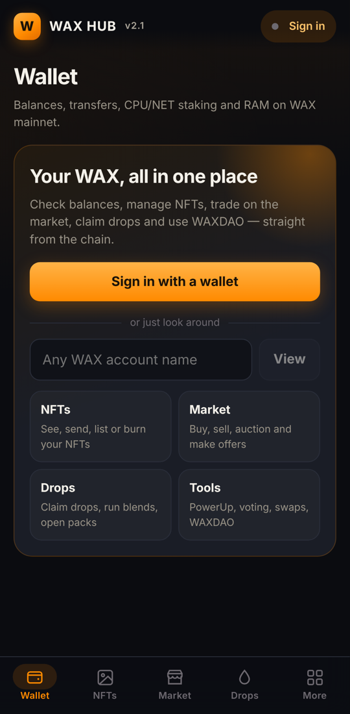
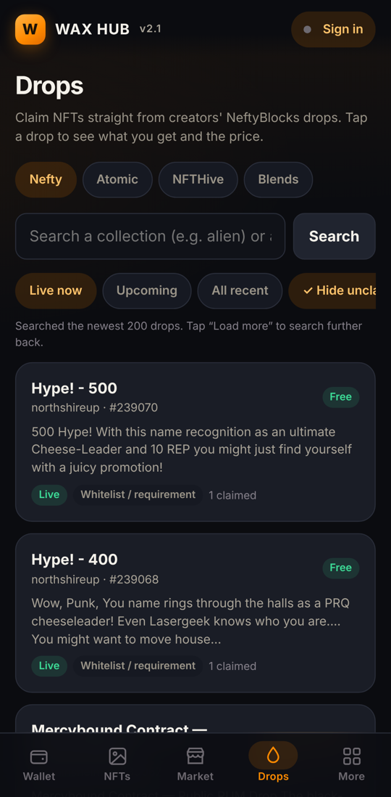
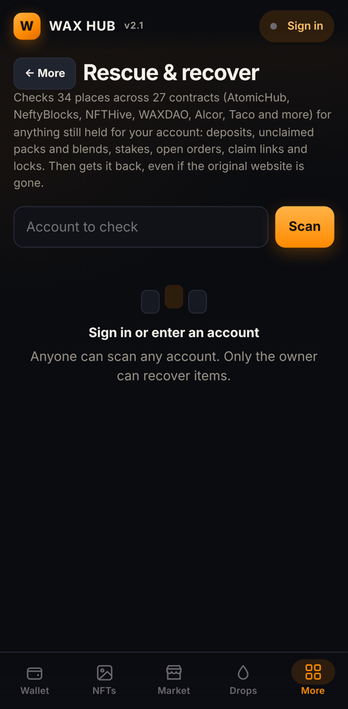
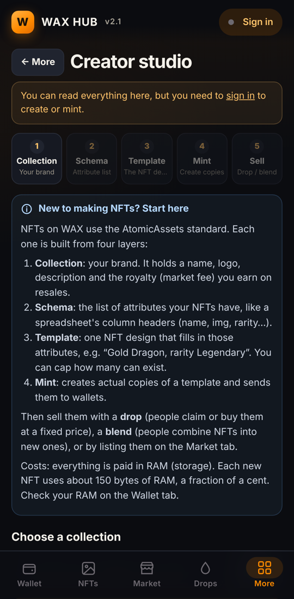

<p align="center">
  
</p>

<h1 align="center">WAX Hub</h1>

<p align="center">
  <b>Your WAX wallet, NFTs, market, drops, creator tools and asset rescue in one free app.</b><br>
  Android and Linux. It talks straight to the WAX blockchain, so it keeps working when other websites shut down.
</p>

<p align="center">
  <a href="../../releases/latest"><b>⬇ Download the latest release</b></a>
</p>

---

## Download

| Platform | File | How to install |
|---|---|---|
| **Android** 6.0+ | `wax-hub-2.1.0.apk` | Open the file on your phone and allow installs from your browser or file manager if Android asks. |
| **Linux** (Ubuntu, Debian, Mint, Pop!_OS) | `wax-hub-2.1.0-amd64.deb` | `sudo apt install ./wax-hub-2.1.0-amd64.deb`, then open **WAX Hub** from your apps menu. |
| **Linux** (any distro) | `wax-hub-2.1.0-x86_64.AppImage` | `chmod +x wax-hub-2.1.0-x86_64.AppImage && ./wax-hub-2.1.0-x86_64.AppImage` |

All files are on the [Releases page](../../releases/latest). Check your download against `SHA256SUMS.txt` on the same page:

```bash
sha256sum -c SHA256SUMS.txt --ignore-missing
```

> **Ubuntu 24.04 and newer:** use the `.deb`. Ubuntu blocks the sandbox that AppImages built with Electron rely on, so the AppImage may not start there.
> **AppImage on older Ubuntu (22.04):** you may need `sudo apt install libfuse2`.

## What it does

<p>
  
  
  
  
</p>

- **Wallet**: balances with USD value, send tokens (with account checks, MAX button and exchange-memo warnings), receive, stake CPU/NET, buy and sell RAM, and warnings when resources run low.
- **NFTs**: view, send, list or burn NFTs, including bulk transfers.
- **Market**: AtomicMarket sales, auctions and buy offers in any token.
- **Drops & blends**: live drops from NeftyBlocks, AtomicHub and NFTHive, hiding old test drops, with collection search. Run NeftyBlocks blends.
- **Rescue & recover**: scans 34 places across 27 contracts for anything still held for you, then gets it back in one tap. That covers leftover deposits, unopened packs, unclaimed auction wins, farm and vault stakes, open orders, unclaimed claim links, unlocked token locks, unstake refunds and voting rewards.
- **Creator studio**: a guided, step-by-step NFT builder (collection → schema → template → mint → sell) with explanations and examples. It includes airdrop minting and a drop builder.
- **Contract console**: call any WAX contract or read any of its tables, even when the project's website is gone. Ready-made tasks and plain-English help on every field.
- **WAXDAO, DEX & chain tools**: farms, DAOs, token locks, swaps, voting, PowerUp, account creation, history and portfolio.

## Your keys stay in your wallet

WAX Hub **never sees your private keys**. You sign in with **WAX Cloud Wallet** or **Anchor**, and every transaction:

1. shows you a plain-English summary first, and
2. only happens after **you approve it in your wallet**.

Reject it in the wallet and nothing is sent. The app talks directly to public WAX mainnet nodes and the AtomicAssets API. There are no accounts, no tracking and no ads.

## Safety tips

- Only download WAX Hub from **this repository's Releases page**. Check the SHA-256 checksum.
- Nobody from WAX Hub will ever DM you, ask for your keys or seed phrase, or ask you to "validate" your wallet.
- In the Contract console, actions that can hand over your account (`updateauth`, `linkauth`, `setcode`) are marked in red. Never run them because someone asked you to.
- Try new features with small amounts first. This is free software provided as-is (see [LICENSE](LICENSE)).

## For developers

- [docs/BUILDING.md](docs/BUILDING.md): build the APK and the Linux app from source.
- [CONTRACTS.md](CONTRACTS.md): every contract and table the rescue scanner covers, and how each was verified.
- [SECURITY.md](SECURITY.md): how to report a vulnerability.
- [CHANGELOG.md](CHANGELOG.md)

Contributions are welcome through pull requests. The maintainer reviews every change before it's merged.

## Licence

[MIT](LICENSE). Third-party components are listed in [THIRD_PARTY_NOTICES.md](THIRD_PARTY_NOTICES.md).
WAX Hub is an independent community project and is not affiliated with WAX, AtomicHub, NeftyBlocks, NFTHive, WAXDAO, Alcor or any other project it works with.
